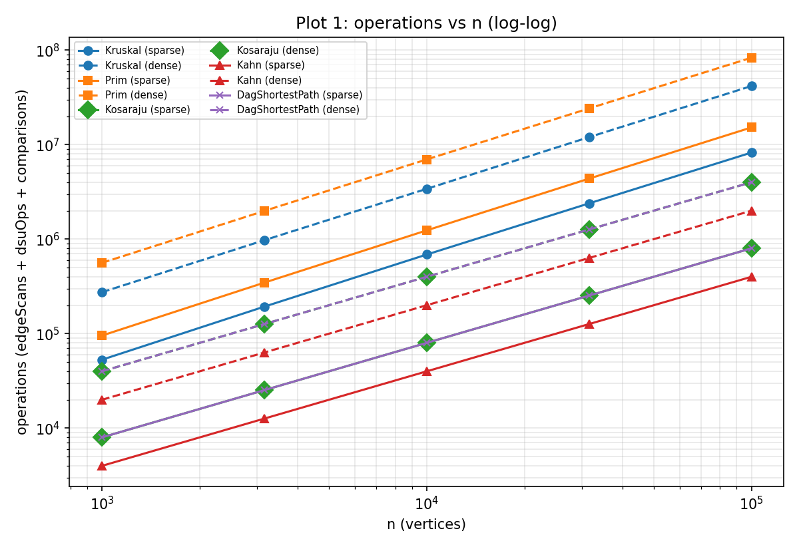
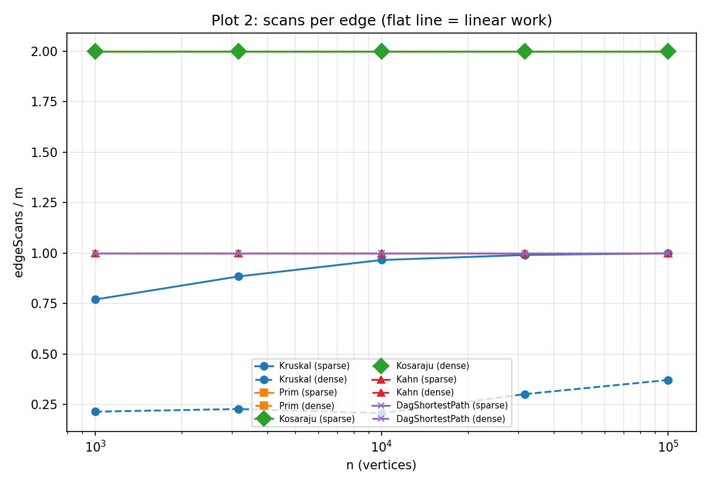
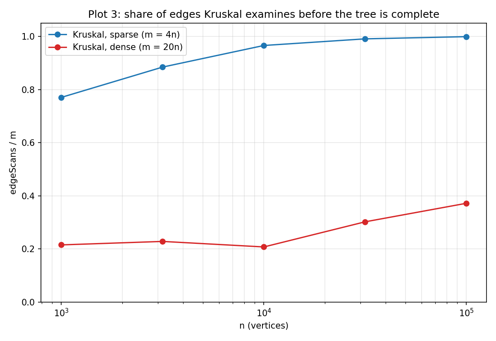

# Assignment 3 — Graphs: DSU, MST, SCC and Shortest Paths in DAGs

Design and Analysis of Algorithms · Student: _name surname, group_ · Repository tag: `v1.0`

All numbers below come from `results/results.csv` (generated with `new Random(42)`, so they are the same on every machine). All ten reference values (MST weight, SCC count, sum of DAG distances) are reproduced exactly; the benchmark stops with an error if any of them, or the equality Kruskal = Prim, or a topological order, is wrong.

## 1. Complexity table

V = vertices, E = edges, α = inverse Ackermann function (≤ 4 for any real input).

| Algorithm | Time | Extra space | Justification |
|---|---|---|---|
| DSU `find` / `union` | O(α(n)) amortized | O(n) | Union by rank keeps trees at height ≤ log n, path compression flattens them further; together m operations cost O(m α(n)). |
| Kruskal | O(E log E) | O(E + V) | Sorting E keys dominates (O(E log E) = O(E log V)); then at most E DSU operations of cost α(V). Extra: sorted key array + DSU. |
| Prim (binary heap, lazy) | O(E log E) = O(E log V) | O(E + V) | Every adjacency entry is scanned once (2E) and may push one heap entry (O(log E)); a visited vertex is skipped when popped. |
| Kosaraju | O(V + E) | O(V + E) | Two iterative DFS passes, each scans every edge once; the reversed graph needs O(V + E) extra memory, stacks need O(V). |
| Kahn | O(V + E) | O(V) | Each vertex enters the queue once, each edge decrements one in-degree once. Extra: in-degree array + queue. |
| DAG shortest path | O(V + E) | O(V) | Topological order (O(V + E)), then one relaxation per edge; `dist[]` and `parent[]` are the extra memory. |

## 2. Counters versus formulas

All counters are incremented inside the algorithms (`dsuOps` inside `find`/`union`, `edgeScans` where an edge is looked at, `comparisons` in the merge sort and in the heap comparator, `maxDepth` at every push to the explicit stack / queue / heap).

| Algorithm | ratio | density | n=1 000 | 3 162 | 10 000 | 31 623 | 100 000 |
|---|---|---|---|---|---|---|---|
| Kosaraju | edgeScans / (V+E) | sparse | 1.600 | 1.600 | 1.600 | 1.600 | 1.600 |
| Kosaraju | edgeScans / (V+E) | dense | 1.905 | 1.905 | 1.905 | 1.905 | 1.905 |
| Kahn | edgeScans / (V+E) | sparse | 0.800 | 0.800 | 0.800 | 0.800 | 0.800 |
| Kahn | edgeScans / (V+E) | dense | 0.952 | 0.952 | 0.952 | 0.952 | 0.952 |
| DAG paths | edgeScans / (V+E) | sparse | 0.800 | 0.800 | 0.800 | 0.800 | 0.800 |
| DAG paths | edgeScans / (V+E) | dense | 0.952 | 0.952 | 0.952 | 0.952 | 0.952 |
| Kruskal | comparisons / (E log₂ E) | sparse | 0.894 | 0.909 | 0.919 | 0.926 | 0.933 |
| Kruskal | comparisons / (E log₂ E) | dense | 0.913 | 0.921 | 0.929 | 0.935 | 0.940 |
| Kruskal | dsuOps / edgeScans | both | 2.13–2.32 | | | | |
| Kruskal | dsuOps / E | sparse | 1.791 | 2.019 | 2.182 | 2.232 | 2.248 |
| Kruskal | dsuOps / E | dense | 0.480 | 0.506 | 0.465 | 0.654 | 0.794 |
| Prim | comparisons / (E log₂ V) | sparse | 2.196 | 2.186 | 2.180 | 2.178 | 2.167 |
| Prim | comparisons / (E log₂ V) | dense | 2.616 | 2.533 | 2.473 | 2.421 | 2.381 |

Reading the table:

* **Traversals are exactly linear.** The ratios are constant to three decimals (they are exactly 2m, m and m scans; the ratio differs between sparse and dense only because V/E differs). This is the expected result.
* **Kruskal sorting** matches E log E: the ratio is almost constant (0.89 → 0.94, a slow drift caused by merge-sort constants at small sizes).
* **Kruskal dsuOps / E is *not* flat on dense graphs**, and the reason is informative: Kruskal stops as soon as the tree has n − 1 edges, so it does not examine all E edges (see Plot 3). Per *examined* edge the DSU cost is constant: dsuOps / edgeScans stays between 2.13 and 2.32 (two `find` calls plus, for tree edges, one successful union), at every size and density. So the DSU really is near-constant per operation.
* **Prim** comparisons / (E log V) stays in 2.17–2.62, slowly decreasing; the lazy heap holds up to E entries but most pushes are shallow.

## 3. Slope check (log-log, least squares over the five sizes)

| Algorithm | density | slope of edgeScans | slope of all operations |
|---|---|---|---|
| Kosaraju, Kahn, DAG paths, Prim | sparse and dense | **1.000** | 1.000 (Prim: 1.10 sparse, 1.09 dense, heap log factor) |
| Kruskal | sparse | **1.055** | 1.095 |
| Kruskal | dense | **1.119** | 1.090 |

The traversals give 1.00, as predicted. Kruskal is steeper than 1, consistent with E log E. Honest remark: for Kruskal the slope of *edgeScans* alone is not purely the log factor — on dense graphs the share of examined edges grows with n (0.22 → 0.37), which adds to the slope; the log factor is visible directly in the comparisons counter (ratio to E log₂ E nearly flat) and in the slope of total operations (1.09).

## 4. Correctness arguments

**Cut property.** Let a cut split the vertices into S and V∖S, and let e be a lightest edge crossing it. Take any MST T. If e ∉ T, adding e to T creates a cycle, and this cycle must cross the cut a second time through some edge f ≠ e. Since e is lightest across the cut, w(e) ≤ w(f). Replacing f by e gives a spanning tree of weight ≤ w(T), so it is also minimum and contains e. Hence there is always an MST containing e, and adding e is safe. Kruskal uses it implicitly: when the next lightest edge joins two different components A and B, the cut (A, V∖A) is crossed by no lighter unused edge (all lighter edges were already processed and are inside components), so the edge is safe. Prim uses it explicitly: the cut is (tree, rest), and the priority queue always returns the lightest edge crossing it. Both therefore only add safe edges, which is why they reach the same total weight (the trees may differ when weights tie) — the benchmark checks this on all ten graphs.

**Induction on the topological order.** Let v₁, …, vₙ be a topological order and let d*(v) be the true shortest distance (starting from the zero-distance sources). Claim: when we reach vᵢ, `dist[vᵢ] = d*(vᵢ)`. Base: sources have no incoming edges, so their distance 0 is final. Step: every shortest path to vᵢ ends with an edge (u, vᵢ), and u comes before vᵢ in the order, so by the induction hypothesis `dist[u]` was already correct when u was processed, and processing u relaxed (u, vᵢ). Every incoming edge of vᵢ was relaxed before vᵢ is reached, so `dist[vᵢ]` equals the minimum over all incoming edges of d*(u) + w(u, vᵢ), which is d*(vᵢ). One pass, O(V + E), is enough, and the proof never used the sign of w. Negative weights are therefore safe in a DAG. In a general graph a vertex can be reached again via a cycle after it was "finished": Dijkstra's greedy argument (a settled vertex cannot improve) breaks with negative edges, and a negative cycle makes shortest paths undefined. A DAG has no cycles, so neither problem can occur.

## 5. Which algorithm when

| Situation | Choice | Why |
|---|---|---|
| MST, sparse graph (E ≈ 4V), edges already in a list | **Kruskal** | Sort is cheap and DSU is near-constant. On our sparse graphs Kruskal examines 77–99.9 % of the edges, but still with fewer counted operations than Prim (about 8.2 M vs 15.2 M at n = 100 000, Plot 1). |
| MST, dense graph (E ≈ 20V) | **Kruskal with early stop** (or Prim with adjacency list) | On dense graphs Kruskal examines only 21–37 % of the sorted edges before the tree is complete (Plot 3); Prim must scan all 2E adjacency entries. |
| Graph given as adjacency list, need to grow from one vertex or the edges arrive online | **Prim** | No global sort; works directly on adjacency lists. |
| Graph given as edge list only | **Kruskal** | Prim would first need to build an adjacency list. |
| Disconnected graph | Both (return a forest) | Both implementations handle it; Prim restarts from the next unvisited vertex, Kruskal simply never reaches n − 1 edges. |
| Directed graph, need cycles / deadlock groups | **Kosaraju** (or Tarjan) | O(V + E), iterative DFS safe for 100 000 vertices. |
| Need an execution order of dependent jobs, cycle possible | **Kahn** | Reports a cycle instead of a wrong order (fewer than n vertices leave the queue). |
| Shortest paths, graph is a DAG (negative weights allowed) | **Topological order + one relaxation pass** | O(V + E), simpler and faster than Dijkstra and valid with negative weights. |
| Shortest paths, cycles possible, weights ≥ 0 | Dijkstra (not part of this assignment) | Needs non-negative weights. |
| Shortest paths, cycles possible, negative weights | Bellman-Ford (not part of this assignment) | O(VE), detects negative cycles. |

## 6. Plots

1. `results/plots/1_operations_vs_n.png` — operations vs n, log-log, one line per algorithm and density (Kosaraju and DAG paths coincide: both 2m operations).
2. `results/plots/2_scans_per_edge.png` — edgeScans / m vs n: flat lines at 2.0 (Prim, Kosaraju), 1.0 (Kahn, DAG paths); Kruskal varies (below).
3. `results/plots/3_kruskal_edge_share.png` — share of edges Kruskal examines: sparse 0.77 → 0.999, dense 0.22 → 0.37.

Plot 3 explains where each MST algorithm wins. On a sparse graph (m = 4n) the spanning tree already uses 25 % of all edges, so Kruskal has to walk almost the whole sorted list (up to 99.9 % at n = 100 000) because the last, heavy edges are needed to connect the final components. On a dense graph (m = 20n) the tree is only 5 % of the edges and the lightest edges are enough to connect everything, so Kruskal can stop after examining about a fifth to a third of the list, while Prim always scans every adjacency entry (2E).

## 7. A paragraph on time

Median times (5 runs) are in the CSV: e.g. at n = 100 000, m = 2 000 000 Kruskal took about 290 ms, Prim 1 270 ms, Kosaraju 204 ms, Kahn 18 ms and the DAG paths 35 ms; on the two smallest graphs times of 0.2–7 ms are mostly noise (JIT warm-up, garbage collection). These numbers were measured on one machine with one JVM and depend on cache size, JIT compilation, GC and background load; on another laptop the ordering of close competitors could change. Therefore the conclusions in this report are drawn from the counters (which are identical on every machine) and the clock only serves as a sanity check: it agrees with the counters in that Prim is the most expensive and Kahn the cheapest, but it is not the evidence.
